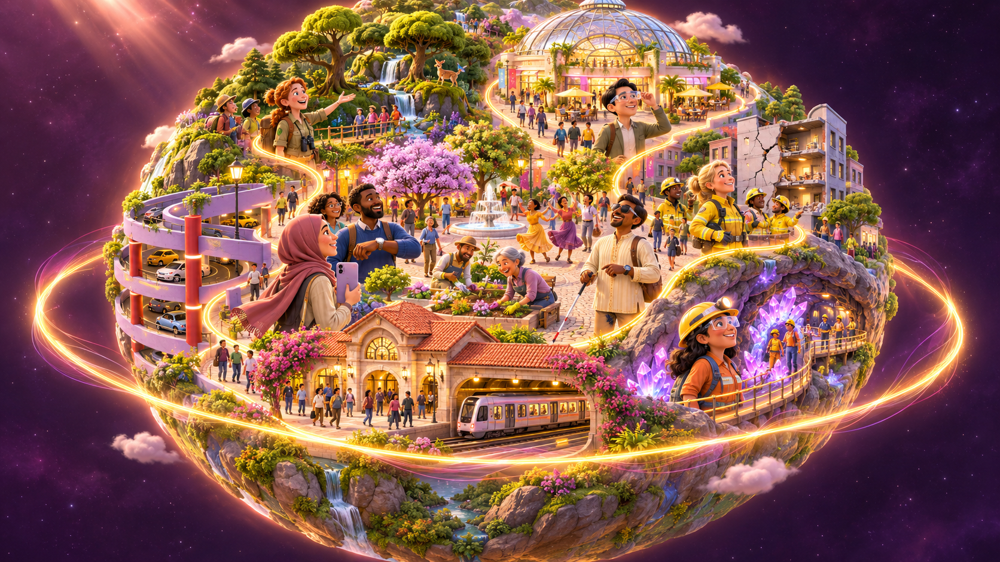
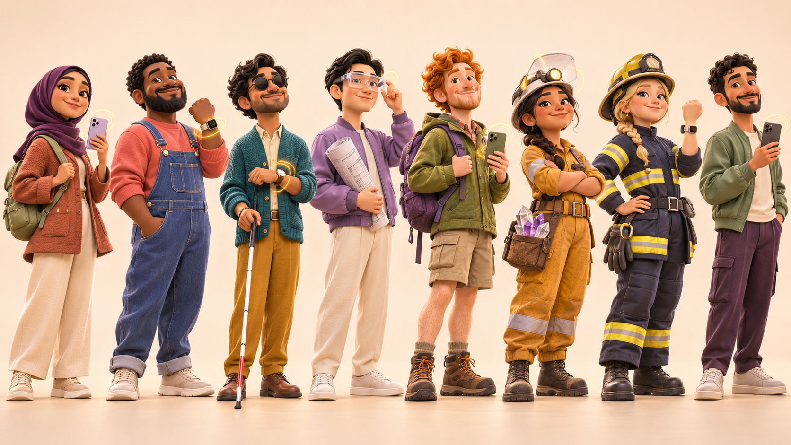
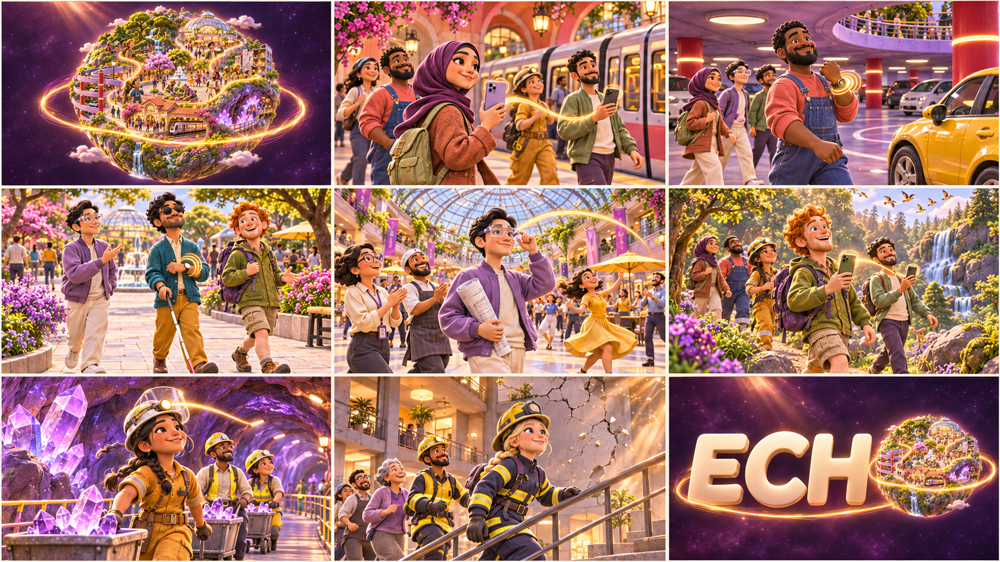
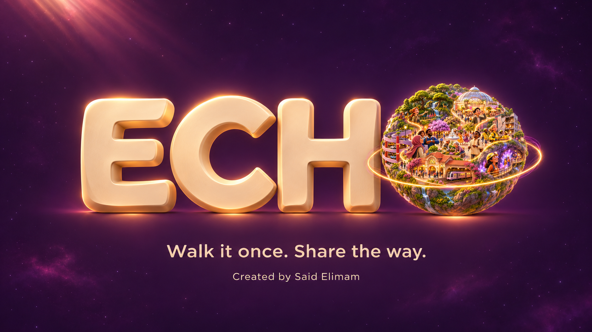

# SIMT ECHO — A Little World. A Shared Way.

> **A joyful 60-second journey around a planet full of people helping one another find the way.**

**Creator / participant:** Said Elimam\
**Format:** Original cinematic 3D animated advertisement, 16:9, 60 seconds maximum\
**Companion:** [ECHO marketing narrative and three-minute film](SIMT_ECHO_MARKETING.md)\
**Creative hook:** One flying camera. One traveling echo. A whole little world connected.

## 1. The film in one breath

A tiny golden pulse wakes in the stars. We chase it toward a little planet, then fly through its metro, parking garage, outdoor plaza, mall, forest, crystal mine, and a damaged building where firefighters guide people toward daylight. Each person receives a little orientation from a device and passes the memory onward. Crowds work, play, dance, and move together. The pulse gathers their paths into one orbit. We pull back into space: the planet settles beside **E C H**, becoming the **O** of **ECHO**.

The story is **“one person's way becomes someone else's possibility.”** It has joyful visual comedy, a clear emotional thread, and no need to read a device display. The magical effects translate guidance and sharing into a language everyone can feel.

**Film classification:** fictional, expressive brand advertisement. The accessibility, mining, rescue, and XR vignettes convey shared orientation; product and safety claims remain those in the main marketing document. Floating paths and projected effects are editorial VFX, rather than literal footage of device capabilities.

## 2. The world and its visual language

### A planet small enough to love

Imagine a hand-sized world with the density of a beautiful music box: coral station roofs, lavender parking ramps, cream pavements, an airy shopping dome, rounded moss trees, violet crystals inside a cutaway mountain, and warm little houses. Sidewalks curl around its surface; clouds look soft enough to squeeze. The whole planet feels inhabited, cared for, and connected.

Keep the Pixar-like warmth, expressive acting, comic timing, and polished 3D feature-animation appeal requested in the brief, with an original cast and world. Rounded silhouettes, tactile fabric, soft skin shading, lovely hair, gentle squash and stretch, and small adult bodies give the characters irresistible charm. Faces remain distinct across ethnicities and ages.

**Art direction:** Deep Space plum `#120A14`; warm ivory `#FFF8F2`; gold `#FFC766` for the traveling memory; ember `#FF8C42`, rose `#FF7E8A`, and violet `#C9A0FF` as supporting echoes. Nature brings moss, teal, and fresh greens. Gold stays the visual thread across all locations.



### One camera, seven neighborhoods

The camera behaves like a graceful FPV drone with a storyteller's attention. It flies into the planet, skims alongside people at their eye level, briefly orbits a gesture, and follows the golden echo to the next person. It accelerates through transition spaces and slows just enough for each useful action to read.

Geography follows a continuous loop: **metro → adjacent parking → outdoor plaza → mall atrium → woodland terrace → mountain mine → rescue block → sky**. The mine and building are exposed cutaways, allowing the camera to enter without teleporting through solid walls. The rescue block connects back toward the plaza, completing the orbit.

Prefer a 20–28 mm equivalent virtual lens for the traveling shots. Keep the character action readable, motion blur restrained, and banking gentle. Hidden joins are allowed inside a passing column, an arch, foliage, dust, or a cloud. The audience should experience one fluid flight.

### A golden echo with personality

The echo is an elegant ribbon of remembered motion. It curls inquisitively, anticipates a turn, and waits a fraction of a beat for people to catch up. It never becomes a speaking mascot or blocks a person's face.

- **Guidance:** a short luminous path grows ahead, with two or three tiny stepping blooms at a decision point.
- **A turn:** the ribbon bends into a soft arc and a warm contour ripple touches the destination landmark.
- **Sharing:** one contour leaves a device, becomes a little route-shaped glyph in the air, and blossoms beside a second person's device.
- **Watch guidance:** small concentric rings pulse around the wrist, timed to a tactile “tap-tap.”
- **AR / XR:** reflected gold touches the glasses or clear visor; the audience sees a free-space route flourish, never a readable HUD.
- **Arrival:** one soft footstep bloom releases a few gold motes, then the ribbon continues to the next person.

Phones face the characters, so the camera sees their backs or edges. Watches remain edge-on or hidden by a sleeve during close passes. No device screen, map, QR, menu, notification, or interface becomes visible in this film. Device gestures and expressive reactions carry the message.

## 3. The cast: small bodies, big personalities

All leads are adults with compact, appealing proportions, large expressive heads, rounded hands, and clear silhouettes. Use a roughly three-to-four-head-high animation target. The generated lineup establishes identities and clothing; the production model sheets should keep the same proportions across shots. Render backgrounds with similarly cute proportions and a broad range of ages, skin tones, and body shapes.



The lineup reads left to right:

1. **Mina — metro.** Arab woman with olive skin, a plum hijab, terracotta coat, cream trousers, and sage backpack. Alert, quick-witted, and generous. Holds a phone with its back toward camera; shares a remembered exit with another commuter.
2. **Malik — parking.** Black father with deep brown skin, tight curls, a soft beard, coral sweatshirt, and blue overalls. Warm comic confidence. Uses his watch to lead his daughter and neighbors to a rounded yellow car.
3. **Arjun — outdoors.** Blind Indian man with brown skin, wavy black hair, a teal cardigan, mustard trousers, and subtle dark glasses. Calm, capable, and socially engaged. Uses wrist cues while his long white cane with a red tip remains active; friends walk alongside him.
4. **Jun — mall.** Chinese designer with neat black hair, lavender bomber jacket, cream trousers, and clear AR glasses. Playful precision. Carries a rolled drawing and leads colleagues through an atrium toward their meeting point.
5. **Rowan — woods.** White red-haired man with freckles, orange curls, moss hiking clothes, and a purple backpack. Infectious enthusiasm. Holds a phone with its back visible and passes the route memory to a fellow hiker.
6. **Ines — cave / mine.** Latina geologist with tan skin, a dark braid, ochre overalls, sturdy boots, and a helmet with a transparent XR visor. Curious and competent. Leads fellow miners and sample carts along a clear crystal-lined passage.
7. **Freya — firefighter.** White blonde woman with a braid, rounded protective helmet, navy-and-yellow kit, and a watch. Steady leadership. Coordinates colleagues and residents moving toward daylight in the damaged-building vignette.
8. **Said — creator avatar.** Arab man with short dark curls, a trimmed beard, sage jacket, ivory shirt, and plum trousers. An original campaign avatar, rather than a portrait likeness. Appears briefly on a plaza balcony during the final ascent, greeting the returning echo. The end card credits **Said Elimam**.

Secondary characters have their own tasks: commuters step in rhythm, a child playfully imitates Malik's wrist gesture, shopkeepers pass parcels in a flowing chain, gardeners trade seedlings, hikers help one another over an ordinary trail step, and miners sort samples together. Firefighters and residents move with composed purpose. Dance belongs in the safe social spaces; teamwork carries the serious settings.

## 4. The exact 60-second script

**Camera rule:** enter each scene already moving, reveal one useful action, then follow its echo outward. Each hero gets a clear gesture and reaction before the next transition. Sparse narration leaves room for music, character sounds, and the choreography.

### 00:00–00:04 · “Hello, little world” · 4 seconds

**Camera / action:** Start in gorgeous plum outer space. One gold mote crosses frame; the camera catches it. A delightfully tiny inhabited planet rotates into view. We accelerate toward it, pass a cloud that briefly resembles a curled footprint, and dive toward the station roof.

**FX / sound:** A crystalline ping becomes a quick ascending glissando. Stars stretch subtly during the acceleration; cloud wisps brush past. Celeste and pizzicato strings introduce the four-note hook.

**VO at 00:01:** “One little world.”

**Transition:** A circular cloud opening aligns with the metro's round skylight. Fly through the skylight and keep the same direction of travel.

### 00:04–00:10 · “A memory catches the metro” · 6 seconds

**Camera / action:** Drop to Mina's shoulder as a rounded train rolls in. She turns her phone slightly toward a second commuter; we see only both phone backs. A tiny golden route glyph hops between them. Three luminous footstep blooms lead toward the correct exit arch. Mina and a cheerful group flow through in an elegant little two-step; a busker's bow lands on the musical beat.

**FX / sound:** Soft phone “bloop,” three-note sharing chime, train-door percussion, sneaker taps. The ribbon loops around a pillar and seems to bow politely as the group passes.

**VO at 00:07:** “So many journeys.”

**Transition:** The camera slips behind the exit pillar; its coral edge wipes into a red pillar in the parking garage.

### 00:10–00:16 · “The car was here all along” · 6 seconds

**Camera / action:** Orbit Malik's raised wrist without revealing the display. Two tactile rings nudge him left. His daughter copies the wrist flourish; two neighbors follow with a synchronized bounce. The ribbon curls toward their yellow car, where the father proudly presents the destination—then notices he is already standing beside its tiny round door. A warm, self-aware grin.

**FX / sound:** Wrist “duk-duk,” a gold corner bloom, a playful double bass pluck, then the car's gentle “pip-pip.” Reflections travel across lilac ramps and polished wheels.

**VO at 00:12:** “One shared memory.”

**Transition:** Follow the ribbon around the car wheel; its circular highlight matches a sunlit planter at the top of the parking ramp.

### 00:16–00:23 · “A direction you can feel” · 7 seconds

**Camera / action:** Emerge into the sunny outdoor plaza at Arjun's walking pace. His cane sweeps the clear, familiar path. A gentle wrist pulse reaches him; he smiles and takes a smooth turn with two friends alongside. The audience sees gold rings by his wrist and a short route arc across the pavement. He responds to the tactile cue, rather than looking at the effect. Gardeners and strolling couples weave through a coordinated background rhythm.

**FX / sound:** Cane contact, wrist taps, fountain notes, soft footsteps. Give the tactile beat a small space in the music so the cue reads without dialogue explaining it.

**VO at 00:18:** “A nudge you can feel.”

**Transition:** The route arc rises toward a mall entrance. The camera follows under a ribbon of festival bunting and through the open glass arch.

### 00:23–00:29 · “Follow the flourish” · 6 seconds

**Camera / action:** Bank around Jun's clear AR glasses; a gold glint crosses the lenses without a visible HUD. A route flourish curls around the atrium's fountain toward the meeting balcony. Jun points with the rolled drawing and leads colleagues in a playful flowing line. Shopkeepers pass packages hand to hand; a florist spins a bouquet; background dancers cross in a gently counter-rotating ring.

**FX / sound:** Glassy shimmer, silk-like ribbon whoosh, parcel “pup-pup,” bright brass answering the string hook. The path feels precisely choreographed through a busy but spacious place.

**Narration:** Let the visual comedy and music breathe.

**Transition:** Skim through the florist's huge leaf; its green fills frame and opens as a real leaf in the woods.

### 00:29–00:35 · “Pass on the adventure” · 6 seconds

**Camera / action:** Fly backward ahead of Rowan and a diverse hiking group along a rounded woodland trail. Rowan passes a floating route-shaped echo from his phone to another hiker's phone, both backs visible. The recipient's delighted eyebrow lift says, “Got it.” Birds arc above, hikers step over a small root in rhythm, and one enthusiastic backpack almost overshoots its owner's turn before settling with a soft bounce.

**FX / sound:** Leaf swishes, bright birdsong, springy backpack “boing,” and the familiar sharing chime woven into the melody. Gold footstep blooms mingle with drifting pollen.

**VO at 00:30:** “A path you can pass on.”

**Transition:** The ribbon slips under an arch of tree roots. The camera follows through a hidden join into the cutaway crystal mountain.

### 00:35–00:42 · “A little light underground” · 7 seconds

**Camera / action:** Enter a luminous violet crystal cave used by a friendly mining crew. Ines wears a substantial XR helmet with a clear pass-through visor; the silhouette supplies the VR-headset feeling while her real surroundings remain visible. The echo reflects across its curved surface and points along an established walkway. She guides colleagues and a gently rolling sample cart toward a familiar passage. In a protected side alcove, a seated colleague briefly wears an opaque VR headset; they remain stationary.

**FX / sound:** Crystal harmonics answer the four-note theme. Sample-cart wheels and gloved sample sorting provide rhythmic clicks. Dust sparkles in soft helmet beams; the echo briefly splits around a crystal, then reunites.

**Narration:** Music and cheerful working sounds carry the scene.

**Transition:** Follow the headlamp into a warm circular flare. It resolves into daylight through a round opening in the next cutaway building.

### 00:42–00:49 · “The way we move together” · 7 seconds

**Camera / action:** Sweep through a stylized crumbling building: cracked pastel plaster, an empty background section shedding little fragments, soft dust, a visibly intact stair. Freya reads a wrist cue without exposing the watch face, gestures calmly, and leads two colleagues and residents along the established path toward daylight. Another firefighter offers a steady hand. Faces show concentration and mutual trust; a relieved smile arrives only at the doorway.

**FX / sound:** Controlled low plaster rumble, soft dust hiss, boots, a protective gloved pat, and warm rising horns. The gold route traces the known passage. It never scans debris, predicts collapse, or discovers a supposedly guaranteed safe exit. Keep falling pieces away from people and avoid graphic peril.

**VO at 00:45:** “Together, we find the way.”

**Transition:** Fly through the bright doorway behind the group, then climb above the neighborhood. The exit bloom sends the golden echo upward with us.

### 00:49–01:00 · “The world becomes the O” · 11 seconds

**00:49–00:52:** Rise over the plaza balcony past Said's friendly wave. Across the tiny world, the seven groups continue their activities in coordinated rhythms. Their route ribbons gather into one delicate orbit. The planet becomes fully visible as the camera retreats into space.

**00:52–00:55:** Slow the pullback. Sculpted warm-ivory **E**, **C**, and **H** enter the composition from the left. The planet settles immediately to their right, matching their cap height and baseline. The golden orbit gently adjusts its angle like a final flourish.

**00:55–01:00:** Hold the completed lockup: **E C H [planet]**. The planet is the only O. A last footprint bloom becomes a small glint on its rim. Tagline and creator credit fade in underneath. The world retains tiny, almost imperceptible motion while the word stays perfectly readable.

**VO at 00:54:** “ECHO. Walk it once. Share the way.”

**Sound:** Full orchestral lift into a bright resolved chord. The sharing chime becomes the final sonic signature; leave a clean, warm tail within the 60-second runtime.

**Exact end-card copy:** `Walk it once. Share the way.` / `Created by Said Elimam`

## 5. Music, sound, and movement score

**Music brief:** modern orchestral cinematic pop, catchy and buoyant, **120 BPM in 4/4**, 30 bars across the minute. A memorable original four-note celeste motif is answered by pizzicato strings, agile woodwinds, warm brass, modern drum accents, hand percussion, and a lightly pulsing electronic bass. Think joyful momentum with a heartfelt lift, rather than a solemn trailer. No borrowed melody and no sung lyrics competing with the narration.

**Arrangement:** 00:00–00:04 wonder and anticipation; 00:04–00:16 playful rhythmic launch; 00:16–00:23 a brief opening in the texture for wrist and cane sounds; 00:23–00:35 the full catchy theme; 00:35–00:42 sparkling cave variation; 00:42–00:49 warm, purposeful heroic lift; 00:49–01:00 expansive final statement and resolved logo chord.

Every handoff uses the same short three-note chime, re-orchestrated for its environment. The echo whoosh moves across the stereo field with the camera, while narration stays centered. Duck the score lightly around useful foley and speech. Keep low impacts controlled and the final tail inside the minute.

Character motion forms a visual orchestra: lead gestures on the beat, companions answering half a beat later, and secondary groups moving in staggered patterns. Scarves, braids, jacket hems, backpacks, leaves, steam, and dust supply follow-through. Give each scene one little comic observation; keep the important route gesture easy to read.

## 6. Generated reference pack

These are still-image art-direction references generated with the built-in imagegen tool. They establish look, cast identity, setting, composition, and the title reveal; they are not rendered video footage. The exact image prompts are saved in [reference-image-prompts.json](marketing-assets/little-world/reference-image-prompts.json).

- [01 — Character lineup](marketing-assets/little-world/01-character-lineup.png): identity and costume reference; left-to-right cast order is defined above. Shot instructions govern device angles and cane movement.
- [02 — Tiny-planet world](marketing-assets/little-world/02-planet-world-reference.png): palette, material, neighborhood density, and the unifying ribbon. Treat its oversized hero figures as illustrative callouts; in the moving film everyone occupies the same world scale.
- [03 — Nine-scene storyboard](marketing-assets/little-world/03-nine-scene-storyboard.png): read left to right, top to bottom: space, metro, parking, outdoor plaza, mall, woods, mine, firefighter, final orbit.
- [04 — Planet-as-O end card](marketing-assets/little-world/04-echo-planet-end-card.png): composition and lighting reference for the final reveal. Typeset the exact final copy separately when assembling the film.





## 7. One master prompt for AI video generation

Copy the entire block below. A plain-text version is available as [master-video-prompt.txt](marketing-assets/little-world/master-video-prompt.txt). Where the chosen generator accepts references, attach the character lineup, planet reference, storyboard, and end card in that order. This prompt specifies the film; available runtime, reference conditioning, audio generation, and typography controls depend on the tool used.

```text
Create a joyful, spectacular, original 60-SECOND-MAXIMUM 3D animated advertisement for SIMT ECHO, titled “A Little World. A Shared Way.” Widescreen 16:9, cinematic 24 fps look, premium family-feature animation, Pixar-like warmth and expressive comic acting with wholly original characters and designs. Small cute adult bodies, large appealing heads, rounded silhouettes, tactile fabric, beautiful hair, soft skin shading, lush miniature environments, rich global illumination, gentle volumetric light. This is a fictional animated brand film; luminous guidance is an editorial visual metaphor. The theme: one person's remembered way helps the next person find theirs.

REFERENCE ROLES: image 1 locks cast identity, ethnicities, clothing and facial features; image 2 locks world materials and palette; image 3 locks scene order and general staging; image 4 locks final title composition. Keep people at one consistent in-world scale. Refine their compact bodies consistently rather than changing proportions between shots.

WORLD: a very small, exquisitely detailed inhabited spherical planet floating in deep plum space, with coral metro roofs, lavender parking ramps, sunny cream outdoor plaza, glass-domed mall, lush moss forest, violet crystal mine inside a cutaway mountain, and a pastel urban rescue block. Many diverse secondary characters work, garden, dance, shop, ride trains, hike, and move together. Everyone feels like part of a caring, happy world. Gold is the shared memory; supporting light is ember, rose and violet. One thin golden route ribbon connects the neighborhoods.

CAMERA: one apparently continuous, dynamic, graceful drone-like fly-through. Begin in outer space, accelerate toward the tiny planet, dive through a cloud and metro skylight, then skim at character eye level through seven connected places before rising back to space. Travel predominantly clockwise around the planet and left to right within scenes. Slow briefly on each useful gesture, then accelerate with the echo. Use restrained motion blur, gentle banking, clear silhouettes and motivated hidden joins behind columns, leaves, roots, dust and clouds. No disorienting spinning, hard montage cuts or impossible wall penetration. Cutaway architecture allows interior access.

CAST: Mina, Arab woman with olive skin, plum hijab, terracotta coat, cream trousers, sage backpack, phone; Malik, Black father with deep brown skin, tight curls, soft beard, coral sweatshirt, blue overalls, smartwatch; Arjun, blind Indian man with brown skin, wavy black hair, teal cardigan, mustard trousers, dark round glasses, long white cane with red tip and tactile watch; Jun, Chinese man with neat black hair, lavender bomber, cream trousers, transparent AR glasses and rolled drawing; Rowan, white freckled red-haired man with orange curls, moss hiking gear, purple backpack, phone; Ines, Latina mine geologist with tan skin, dark braid, ochre overalls, safety helmet with clear pass-through XR visor; Freya, white blonde woman firefighter with braid, rounded helmet, navy-and-yellow protective gear and watch; Said, Arab male creator avatar with short dark curls, trimmed beard, sage jacket, ivory tee and plum trousers, briefly waving from plaza balcony during ascent. Distinct faces and personalities, no caricatures. Background cast is equally diverse.

ABSOLUTE DEVICE RULE: NEVER show actual phone or watch screens, maps, QR codes, menus, app interfaces, notifications, readable HUDs or floating UI panels. Phones show their BACKS or edges, watches remain edge-on or obscured. We understand use through a wrist gesture, a subtle vibration, a sharing gesture, a face reacting, and beautiful external gold VFX. AR glasses and clear visors show subtle reflected light only. One opaque VR headset may appear only on a seated stationary colleague in the mine's protected side alcove. Walking characters retain a clear view of their surroundings.

00:00–00:04 SPACE: a tiny gold mote awakens among plum stars. Camera chases it toward the complete little planet, through a soft footprint-like cloud opening and into the station skylight. Wonder, delight, immediate motion.

00:04–00:10 METRO: camera flies beside Mina as a rounded train arrives. She shares a small route-shaped gold glyph from the BACK of her phone to the BACK of another commuter's phone. Three soft footprint blooms lead to the exit arch. A diverse commuter group follows with a cheerful synchronized two-step; a busker bows on the beat. Follow the ribbon behind a coral pillar, which wipes into a red garage pillar.

00:10–00:16 PARKING: circle Malik's wrist from the side, hiding its display. Two tactile gold rings suggest a turn. His daughter imitates his wrist flourish and neighbors follow. A ribbon curls to their rounded yellow car. He proudly presents it, then realizes he is already beside the door and gives a lovable sheepish grin. Follow the wheel highlight to a circular planter at the top of the ramp.

00:16–00:23 OUTDOORS: emerge into a sunny pedestrian plaza with Arjun confidently using his long white cane on a clear established path, two friends alongside. His watch gives a tactile pulse, visible to the audience as gentle wrist rings. He responds to the felt cue and calmly turns, without looking at the light effect. Cane remains in use. Gardeners trade seedlings; couples cross in a graceful rhythm. Follow the short gold route arc under bunting and through the mall arch.

00:23–00:29 MALL: camera glides around Jun's clear AR glasses, catching a gold reflection without a HUD. A delicate free-space ribbon curls around the fountain to a meeting balcony. He leads colleagues using a playful gesture with his rolled drawing. Shopkeepers pass parcels, a florist turns a bouquet, cheerful background dancers weave in a spacious ring. Fly through a giant decorative leaf; emerge through a matching woodland leaf.

00:29–00:35 WOODS: fly backward at eye level ahead of Rowan and a diverse hiking group. He shares a gold route glyph between two phones with their backs visible. The second hiker reacts with a delighted eyebrow lift. Hikers step over a small ordinary root in rhythm; one backpack bounces comically after its owner turns. Birds arc above, pollen catches the route light. Follow the ribbon under an arch of roots into the mountain's exposed cave.

00:35–00:42 CAVE / MINERS: reveal a gorgeous violet crystal mine with an established walkway. Ines wears a large XR helmet with a clear pass-through visor, receives a reflected gold cue, and leads coworkers and a sample cart around a known bend. Coworkers sort samples and move together with warm competence. A seated worker in a protected side alcove briefly wears an opaque VR headset. Sparkling dust, crystal harmonics, helmet beams; no visible screens. Follow the headlamp into a circular flare that opens onto the rescue building.

00:42–00:49 FIREFIGHTER: sweep through a stylized crumbling cutaway building with cracked pastel plaster, small fragments falling in an EMPTY distant background, soft dust rays and a clearly intact stair. Freya receives a wrist cue from an angle hiding the display, gestures calmly, and leads colleagues and residents along an established passage toward daylight. Another firefighter offers a steady hand. Coordinated professional movement, reassuring warmth, no dancing in danger, no graphic peril or injury. Gold represents a remembered path, never obstacle scanning, collapse prediction or a guaranteed safe route. Follow the group through the bright doorway, then climb with the exit bloom.

00:49–01:00 FINALE: rise past Said waving from the plaza balcony, then reveal all seven communities continuing their activities in harmony. The gold routes unite into a single elegant orbit. Camera zooms out until the whole little planet is visible. By 00:55, sculpted ivory 3D letters E C H sit to its left; the planet settles at exactly the same cap height and baseline and IS THE LETTER O. The final word reads E C H [PLANET], visually ECHO. NO additional O, no extra letter, no planet inside a separate O. Hold 00:55–01:00 with minimal world motion and readable typography. Under the title, exact text: “Walk it once. Share the way.” Beneath that, smaller: “Created by Said Elimam”. A last footprint glint becomes a star on the planet rim.

FX GRAMMAR: one elegant gold memory ribbon with tiny ember/rose/violet contour echoes; sharing glyph blooms between two devices; short footstep blooms; soft directional arcs; tactile wrist rings; delicate lens reflections; a warm arrival bloom. Effects support gestures and faces, never obscure them. Every transition follows an echo, a gesture, a rounded shape or an architectural opening. Faces, outfits and device shapes stay consistent. Cloth, hijab folds, braids, backpacks, foliage, steam and dust have lovely secondary motion.

MUSIC: original, catchy modern orchestral cinematic pop at 120 BPM in 4/4. Celeste four-note hook, pizzicato strings, agile woodwinds, warm brass, modern percussion and subtle electronic bass. Playful opening, rhythmic metro/parking, breathing room for outdoor tactile cues, exuberant mall/forest theme, crystal cave variation, warm purposeful rescue lift, expansive final chord. No borrowed melody, no sung lyrics. Sharing always uses the same short three-note chime. Add train-door percussion, foot taps, wrist duk-duk, fountain notes, leaf whooshes, cart clicks, crystal tinkles, controlled plaster rumble, and a soft final sonic signature. Spatialize whooshes with the moving camera; center and clearly mix narration. Keep the final sound tail inside sixty seconds.

SPARSE WARM VOICEOVER, exact words at approximate times: 00:01 “One little world.” 00:07 “So many journeys.” 00:12 “One shared memory.” 00:18 “A nudge you can feel.” 00:30 “A path you can pass on.” 00:45 “Together, we find the way.” 00:54 “ECHO. Walk it once. Share the way.” Let music and acting carry the gaps.

QUALITY CONSTRAINTS: no real human footage, no stock footage, no recognizable franchise characters, no stereotypes, no generic identical faces, no floating phones, no changing ethnicity or clothing, no extra fingers, no visible device displays, no illegible title, no duplicate O, no random text, no watermark, no graphic injury, no children operating mine or rescue equipment, no implausible mobility-aid disappearance, no opaque headset on a walking person. Joy, usefulness, visual comedy and shared humanity remain the emotional center. Total duration MUST NOT EXCEED 60 seconds, including the five-second final hold.
```

## 8. Assembly notes for a beautiful final result

Generate the nine timed beats separately if the selected video model cannot reliably sustain a full-minute camera move or maintain the entire cast. Use the master prompt as the common brief and the relevant timed paragraph as the active shot. Carry the previous shot's final composition into the next shot's starting frame where supported. Hidden joins preserve the continuous-flight illusion.

Lock each lead's face and outfit to the lineup. Use the storyboard as composition guidance, then stage the actions from the script: a still can establish a setting without containing every action. Keep phones back-facing, suppress incidental readable watch displays, preserve Arjun's cane, and distinguish transparent AR visors from the stationary opaque headset.

Build the final E C H typography and text credit as clean composited elements. Match the planet's diameter to the letters' cap height and leave enough horizontal room for the final word. The generated end card guides composition; separately typeset text guarantees exact spelling and readability. No additional O should remain behind or around the planet.

Compose or generate the score as a separate 60-second cue if the video tool lacks dependable synchronized audio. Layer the exact VO and foley onto that cue, with transition sounds bridging the hidden joins. Supply captions for all spoken lines and preserve a readable five-second end hold. The finished export, including its audio tail, ends at **01:00**.

**The final feeling:** a world that moves beautifully because people keep passing on what they know.

**SIMT ECHO — Walk it once. Share the way.**\
**Created by Said Elimam.**
