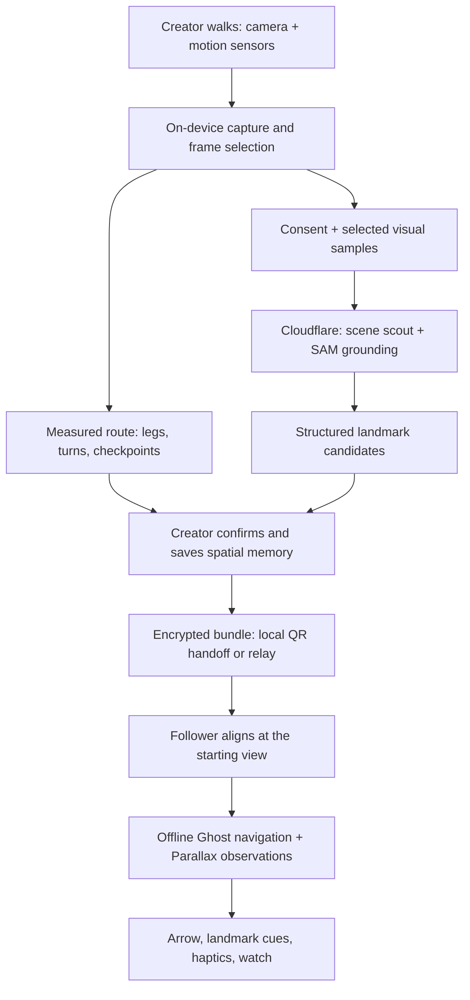

# SIMT ECHO — Give Unmapped Places a Memory

> **Walk it once. Share the way.**\
> One person explores. Another person finds the way.

**Creator / hackathon participant:** Said Elimam\
**Occasion:** Meta Global AI Developer Hackathon 2026\
**Purpose:** Product narrative, technical storytelling, submission copy, and a three-minute showcase film\
**Date:** 3 November 2026

---

## Read this in three layers

- **Understand the product:** [The idea](#1-the-idea-a-walk-that-outlives-the-walker) → [The experience](#2-the-experience-two-people-one-shared-memory).
- **Understand the invention:** [Architecture](#3-the-architecture-three-kinds-of-intelligence) → [Meta AI](#4-meta-ai-turning-seeing-into-recognizing) → [Ghost](#5-ghost-navigation-that-reasons-about-uncertainty) → [Parallax](#6-parallax-the-first-walk-teaches-the-second-how-motion-looks).
- **Tell the story:** [Design](#7-luminous-an-interface-that-echoes-the-body) → [Trust](#8-private-portable-and-built-for-the-phone) → [Judge takeaways](#9-what-judges-should-remember) → [Three-minute film](#10-the-three-minute-film-the-second-walk) → [Submission copy](#11-ready-to-use-pitch-and-submission-copy) → [Questions](#12-judge-questions-clear-answers).

## 1. The idea: a walk that outlives the walker

### The human problem

You reach an underground parking garage. A friend is waiting near a lift. Their message says, “Take the second left, then find the red pillar.” Every corridor looks similar. Your outdoor map cannot explain the next turn. Someone already knows the way, but their knowledge is trapped in their memory.

**ECHO makes that knowledge transferable.**

A person walks a route with an ordinary smartphone. ECHO captures their movement, identifies recognizable landmarks, and packages the journey as a small spatial memory. Another person receives it, aligns at the starting view, and follows that same route with local guidance—even without GPS or internet access during navigation.

The useful unit is a **walked path**: where to begin, how the journey unfolds, what to recognize, when to turn, and how to know you have arrived. A whole building does not need to be mapped for one visitor to find one destination.

### The product in one sentence

> **SIMT ECHO turns one person's walkthrough into another person's offline guide, combining measured motion, Meta AI landmarks, and on-device spatial reasoning.**

### Why the idea matters

People already create spatial knowledge simply by moving through the world. ECHO gives that knowledge a portable form. The person who finds the entrance, meeting room, or lift can pass on the experience instead of composing a fragile paragraph of directions.

That creates value wherever a specific recorded journey matters: a companion finding a parked car, a visitor reaching a meeting point, or an event organizer sharing the walk from an entrance to a registration desk. These are human-scale navigation problems that can be solved without installing beacons or commissioning a floor plan.

**The larger idea: everyday experience becomes useful infrastructure for the next person.**

## 2. The experience: two people, one shared memory

### Act I — “I found the way.”

The creator opens ECHO and records a walk. Motion sensors capture steps and headings; the camera supplies visual context. A trail grows with the walk. Turns become nodes. A useful view earns a brief gold bracket as the phone selects it for the route's visual memory.

ECHO curates frames by sharpness, exposure, stability, and novelty. The creator can mark a meaningful checkpoint while walking. At the destination, the journey becomes a route story: a distance-linked filmstrip, a path, and recognizable places along it.

### Act II — “Here is what to look for.”

With the creator's consent, selected visual samples go through the AI pipeline. Scene understanding proposes useful permanent objects; SAM grounds them in the actual images and follows them across the approach. A red pillar becomes a checkpoint with a visible shape, a short description, and a cue tied to a measured turn.

The creator chooses, edits, or draws landmarks and confirms the route. Route Health identifies weak sections: a long leg without a visual anchor, an ambiguous turn, or a destination that needs a clearer label. Route Polish uses the complete captured trace to refine heading consistency and preserve uncertainty for each leg.

### Act III — “Now your phone remembers it.”

The creator presents a QR code carrying the connection details and key material. The receiving phone downloads the encrypted route over a local network or hotspot. A route sigil—a small glyph generated from the journey's geometry—appears on both devices, making the handoff visually recognizable.

The QR pairs the phones; the route data travels separately. An encrypted relay supports situations where direct local transfer is blocked, and deliberate file export provides another way to carry the route.

### Act IV — “I can follow it myself.”

The follower matches the starting photograph and faces the route's initial direction. From that point, guidance runs on the receiving phone: an arrow, a distance, a landmark, a turn haptic. The route remains usable with mobile data and Wi-Fi switched off after transfer.

As the follower moves, Ghost combines evidence about progress. Parallax supplies visual motion observations. A recognizable checkpoint lets the person explicitly confirm their position. If confidence weakens, the interface shows it; Relock gathers fresh evidence to recover a position along the recorded route. At the destination, the arrow becomes a check and the arrival bloom completes the story.

**The emotional payoff is independence: someone else's experience helps you get there yourself.**

## 3. The architecture: three kinds of intelligence

ECHO gives each subsystem a precise job. Motion estimation establishes the traveled path. AI attaches meaning to observed places. Navigation reasons about where the follower is on that path. This division makes the system easier to understand, extend, and trust.



### Layer 1 — The phone measures and remembers

The Kotlin Multiplatform core owns route models, capture algorithms, navigation, storage, and bundle handling. Android adapters connect that core to CameraX, inertial sensors, pressure, haptics, and device services. Compose Multiplatform renders the experience through the Cosmos and Luminous design languages.

The route graph contains ordered nodes and legs, a relative path, landmark evidence, and optional perception data. Its coordinates belong to the recorded journey. Sensor-derived distances remain estimates; their uncertainty travels with the route rather than disappearing behind a polished line.

### Layer 2 — The cloud makes visual evidence useful

A TypeScript Cloudflare Worker handles consented uploads, validation, provider routing, and jobs. Hono supplies the request layer, Zod validates contracts, Workflows coordinates durable processing, R2 holds temporary media and results, and Workers AI supplies scene interpretation. Meta Model API integrations add Muse Spark semantics and SAM segmentation and tracking.

The cloud returns structured checkpoint candidates. Model output can attach a description or shape to an existing checkpoint; it cannot invent a new corridor or rewrite the recorded path.

### Layer 3 — The receiving phone guides locally

The follower carries the information needed to navigate: route geometry, confirmed cues, permitted landmark imagery, and compact perception descriptors. Ghost and Parallax consume local sensor and camera observations. Navigation has no dependency on a cloud response while walking.

**Architecture in everyday language:** the first phone records the experience, AI makes it readable, and the second phone uses it independently.

## 4. Meta AI: turning seeing into recognizing

### Scene understanding asks, “What will help a stranger?”

Meta's **Llama 4 Scout**, served through Cloudflare Workers AI, interprets selected checkpoint views and route context. **Muse Spark 1.3** provides an additional semantic provider through the Meta Model API. Provider routing keeps a common candidate contract, so the product can use configured models without changing the navigation engine.

The task is concrete: find a permanent, distinctive object that a stranger can recognize while approaching a decision point. A painted pillar, stair railing, lift entrance, or fixed sign is useful. A passerby or parked vehicle is a poor anchor. ECHO considers permanence, distinctiveness along the route, ambiguity, and privacy risk.

The turn and distance supplied to the model come from captured motion. The resulting cue combines that measured context with visual meaning: **“Turn left at the red pillar.”**

### SAM asks, “Where is the object, and does it persist?”

**SAM 3.1** grounds candidate objects in frames with segmentation masks or boxes and tracks them across selected approach views. The system relates those observations to the capture timeline and odometer, connecting an object to the point from which it becomes visible along the recorded approach.

This makes segmentation useful beyond an attractive overlay. It supports a cue that arrives when a traveler can start looking for the landmark. ECHO links a named object, its visual evidence, and its place in the journey.

### SAM Lens spends computation where it helps

The phone assembles short, curated **approach strips** from the glimpse ledger. These are small sequences of selected images around a checkpoint, distinct from the compact numeric view strips used by Parallax. A frame-to-distance sidecar preserves where each image belongs along the walk.

SAM Lens uses an image-first escalation ladder: assess candidates on a selected still, then use short video sequences when temporal evidence is valuable. It prioritizes destinations and turns, reserves a frame budget, bounds concurrent work, and uses content-hash caching. Completed cached work can be reused within the job or an explicit resumed job instead of submitting the same evidence again.

Uploads resume by hash; job creation is idempotent; checkpoint results stream as they arrive. A constellation in the interface shows those actual events. Optional Wi-Fi-only preparation during the walk starts only after advance consent.

**Judge takeaway:** Meta models perform complementary physical-world tasks—semantic selection and visual grounding—inside a controlled pipeline whose output serves a real journey.

## 5. Ghost: navigation that reasons about uncertainty

### Many plausible positions, one useful estimate

Imagine several transparent versions of the traveler placed at plausible points along the saved route. Each has a slightly different stride estimate and heading offset. Every step moves those hypotheses forward. A turn, a landmark, a pressure change, or a visual match makes some explanations more likely and others less likely.

That is the intuition behind **Ghost's along-route particle filter**. Its hypotheses track three quantities: distance along the route, the follower's stride scale, and heading bias. It estimates a position and the spread of plausible positions, expressed as uncertainty, **σ**.

The route constrains the search. ECHO asks where a person is on a known journey, which makes each observed turn or checkpoint especially informative.

### Evidence comes from different physical signals

- **Steps and heading:** motion provides continuity between checkpoints, with heading quality controlling how strongly it is trusted.
- **Turn sequences:** a left–right–left pattern helps distinguish progress along the route; sequence matching tolerates differences in walking pace.
- **Confirmed landmarks:** an explicit “I see it” provides a strong human anchor. A visual resemblance alone remains a soft observation.
- **Barometric change:** relative pressure helps identify movement between levels when the device supports it.
- **Magnetic signatures:** variations along a corridor can help recognize progress when the recorded pattern is distinctive. Steel-related variation becomes contextual evidence, with quality gates, rather than unquestioned compass truth.
- **Visual fingerprints:** compact on-device descriptors compare current views with stored checkpoint and waypoint appearances.
- **Parallax and ViewFix:** image motion and view-strip sequences add evidence about movement, relative heading, and position.

### A guide that adapts to the person

Two people need not take the same number of steps to traverse a corridor. Ghost learns the follower's stride relative to the creator's route from anchored legs; Parallax adds evidence between anchors. The useful relationship is progress in the route's own distance system.

When the follower selects **Relock**, hypotheses spread across the route and converge using new evidence. If the place remains ambiguous, ECHO offers a return to a known checkpoint or a restart. The uncertainty aura visibly reflects that ambiguity.

**Judge takeaway:** confidence is part of the product's behavior. ECHO can explain when the available evidence is insufficient to give a confident direction.

## 6. Parallax: the first walk teaches the second how motion looks

### The insight, without the equations

Walk toward a nearby pillar: its image expands quickly. Walk toward a distant wall at the same speed: the expansion is slower. Camera motion therefore mixes two things—how you move and how the surrounding space is shaped.

ECHO has a valuable reference: **someone has already walked this corridor**. During that first walk, it records how the scene's apparent expansion changes per unit of traveled distance. During the second walk, it compares current expansion with that stored profile to estimate progress in the creator's distance system.

**The first walk teaches the second phone what movement looks like in this place.**

### The ratio, with a simple example

Let **ρ(s)** be the creator's visual expansion per recorded metre at position **s**. The follower measures expansion per second. ECHO forms the observation:

```text
visual speed in the route's metres/second
    ≈ follower expansion/second ÷ creator expansion/route metre
```

For intuition, suppose the creator records an expansion factor of 0.10 per route metre at one location. If the follower measures 0.08 per second there, the ratio suggests 0.8 route metres per second. These are explanatory numbers, not a performance measurement.

The shared geometry cancels to first order under compatible views and estimators. The result is relative to the creator's estimated metres; it does not require a monocular camera to produce calibrated absolute depth. ECHO checks estimator compatibility, view usability, trackability, and uncertainty before using the observation.

### How a small visual engine supports the idea

Parallax reads low-resolution luminance from the existing camera analysis stream. Gyroscope-aligned rotation compensation separates phone rotation from scene motion. Pyramidal block matching estimates residual flow, and robust fitting reduces the influence of moving objects and inconsistent blocks. The focus of expansion helps distinguish where the phone points from the direction the person travels.

The visual channel also provides an independent witness for motion: a shaken accelerometer should not automatically imply forward progress. Heading fusion combines gyro behavior, quality-gated magnetic orientation, and visual evidence. Unreliable visual observations lose influence.

### ViewFix: a place can carry a tiny geometric signature

Along the route, ECHO stores **96-byte view strips**: normalized one-dimensional summaries with 64 column values and 32 row values. A sequence of strips helps distinguish repeated-looking corridors; shifts and changes of scale provide relative heading and along-route offset observations. Sequence agreement and separation from competing matches gate the result.

These summaries are not source photographs, and their reduction discards substantial image detail. They still encode location-related information and receive the same privacy protections as other sensitive route data.

The route also carries compact expansion and trackability profiles. Route Polish uses the complete recorded trace to refine heading consistency and represent per-leg uncertainty. A local route-memory overlay retains useful descriptors from successful follows, adapting later use to that follower's phone and appearance conditions without rewriting the shared bundle.

### Graceful behavior is part of the invention

A blank wall, glare, darkness, unsuitable hold angle, or dynamic crowd can make camera evidence weak. Parallax reports usability and confidence; Ghost continues on the remaining evidence. The interface can say **“Blank wall — using steps.”** A visual-lock ring lights only while visual evidence is actually contributing.

**Judge takeaway:** ECHO reuses knowledge of a specific traveled route to make lightweight visual motion useful, while retaining a sensor-based path through difficult camera conditions.

## 7. Luminous: an interface that echoes the body

ECHO's visual identity expresses the product itself. The **Echo Step** mark is a footprint surrounded by contour echoes: one person's step reaching the next traveler. Each route's sigil turns its path into a recognizable visual identity that survives the handoff between phones.

Cosmos supplies Deep Space and Daylight Nebula themes, semantic accents, typography, focus treatment, and accessible components. Luminous adds responsive movement and multisensory guidance. Ember marks agency, gold supports precision, and cyan marks live information. The dark field and restrained aurora create atmosphere while leaving reading areas clear.

### “Honest light”: the interface makes system behavior visible

- A **step ripple** follows a real step event.
- A **node bloom** marks a route event or arrival.
- A **constellation star** reflects a checkpoint's processing state.
- **Transfer particles** follow measured byte progress.
- The **arrow morphs** with the navigation phase and upcoming turn.
- An **uncertainty aura** represents the spread of Ghost's position estimate.
- A **peripheral glow** grows on the turning side as the decision approaches.
- A **visual-lock ring** indicates that camera observations are contributing.

At decision points, haptics use distinct rhythms for left, right, U-turn, warning, confirmation, and arrival. A heartbeat quickens toward a turn. Opt-in headphone earcons pan toward the indicated direction and yield to TalkBack speech. Wear OS carries the arrow, distance, next cue, and wrist haptics; Android Live Updates expose glanceable progress.

Full, Reduced, and Static motion modes preserve the same information and task outcomes. Touch targets are at least 48 dp; text respects system scaling; status has labels and shape cues as well as color. A practice tour teaches the navigation language before a real walk.

**Judge takeaway:** the expressive design communicates evidence, progress, and decisions. Beauty helps the traveler understand the system.

## 8. Private, portable, and built for the phone

### Privacy is a sequence of deliberate choices

Recording and frame selection happen locally. Cloud enrichment requires consent. Selected samples pass through an on-device face filter before upload; frames flagged by that filter are withheld. The creator controls landmark selection and the contents of an export. Raw route video stays private rather than becoming a default shared asset.

The route transfer is sealed with **AES-256-GCM**, and container integrity uses **SHA-256**. Local transfer uses a pairing token; possession of the QR grants access to its connection and key material, so showing it is an intentional act of sharing. An encrypted relay carries ciphertext while the decryption key remains in the pairing information.

Plain `.echo` file export is an explicit choice with a privacy warning. Perception data is excluded from plain export unless opted in. Temporary cloud media has expiry and deletion controls. Local routes, derived memories, and related data have erasure paths. Deleting a local copy cannot recall copies someone else has deliberately received.

Visual fingerprints, view strips, and spatial profiles are treated as sensitive derived data. They stay out of cloud AI payloads; they can travel in the protected route bundle when selected for sharing. Follower-side route memory stays local and expires with its route.

### Efficient intelligence at each layer

One shared camera analysis stream serves frame selection and visual motion. It avoids competing camera owners. Reused buffers and allocation-conscious numerical kernels keep repeated work small; sensor and media work run away from the UI thread.

The visual scheduler spends effort according to information need: more near turns, ambiguity, or high uncertainty; less on a confident straight segment; no visual-motion work while standing. Particle count adapts to uncertainty. Thermal and power conditions reduce work. On the cloud side, image-first grounding, bounded budgets, hash-based upload resumption, and scoped caching limit unnecessary processing.

The compactness is tangible: a ViewFix strip is 96 bytes, expansion and trackability use one byte each per half-metre bucket, and the perception contract caps its JSON payload at 64 KiB. These are representation sizes and contract bounds; route length and selected media determine the complete bundle size.

The shared Kotlin core separates algorithms from platform adapters, and additive route contracts preserve compatibility. Hardware-specific sensing remains explicit: the phone uses the observations its sensors and current conditions can support.

**Judge takeaway:** ECHO makes local autonomy, user control, and resource discipline part of the architecture.

## 9. What judges should remember

### 1 — A clear human payoff

Someone who has never traveled a route can benefit from someone who has. The two-phone handoff makes that value visible in seconds.

### 2 — AI with a specific physical purpose

Meta scene understanding selects recognizable anchors. SAM grounds and tracks them. The output becomes a cue for a real decision along a measured path.

### 3 — A distinctive technical combination

Route-conditioned visual speed, probabilistic along-route tracking, compact view-strip localization, creator-confirmed landmarks, and uncertainty-aware guidance work together around a known journey. The originality lies in how these pieces make experience transferable.

### 4 — A memorable product language

The footprint, route sigil, constellation, morphing arrow, and arrival bloom tell one coherent story: movement leaves an echo another person can follow.

### 5 — A credible path to useful reach

Ordinary phones capture and receive routes. A friend, host, or organizer can share a particular journey without installing building infrastructure. Local transfer and offline following suit places with unreliable connectivity. This is a strong fit for physical-world AI and personally useful technology.

**Closing thought:** a destination pin tells someone where you are. An ECHO passes on how you got there.

## 10. The three-minute film: “The Second Walk”

### Creative concept

**Two people. Two walks. One memory crossing between them.** Start with a human message—“I'm by the lift”—and end with the recipient arriving. Use a gold route ribbon as the visual thread. It begins at a footprint, follows the creator, crosses the phone handoff as the route's real sigil, and resolves into the follower's arrival check.

The film contains **eight mini-films**, edited into one continuous **180-second** story. Each has a distinct visual grammar: suspense, human capture, AI object portrait, handoff, motion explanation, navigation, design montage, and creator address. Match cuts keep them connected. The spoken track is reproduced below; labels, captions, and production directions are not spoken.

### 00:00–00:15 · Mini-film 1 — “The last message” · 15 seconds

**Picture:** Underground corridor. Close-up: “I'm by the lift.” A person stops at two similar passages. Sound drops to footsteps and room tone. At the question below, one footprint sends a gold contour through the darkness; cut to the Echo Step mark.

**Spoken:** “Your friend sends a location. You reach the building. Then the map stops helping. But someone already knows the way. What if their walk could become your guide?”

**On-screen:** “Some directions are lived.” → “SIMT ECHO”\
**Transition:** The footprint contour becomes the Record button's ripple.

### 00:15–00:38 · Mini-film 2 — “Teach the place” · 23 seconds

**Picture:** Phone A records the corridor. Match each visible step to a ripple. Show a turn node blooming, a selected frame's gold brackets, and the distance-linked route story. Keep the creator's real surroundings recognizable across the cuts.

**Spoken:** “ECHO turns a walkthrough into a shareable spatial memory. I walk, and the phone captures motion, turns, and useful views. The route grows beneath my steps. ECHO chooses clear, distinctive frames and builds a journey around places another person can recognize.”

**On-screen:** “Walk → Capture → Remember”\
**Transition:** A selected pillar frame fills the screen and becomes the next object portrait.

### 00:38–01:00 · Mini-film 3 — “Give the memory meaning” · 22 seconds

**Picture:** Use actual scene-understanding output and SAM artwork over the matching source frame. A mask traces the pillar. A small approach sequence shows the object persisting. End on the confirmed cue attached to the recorded turn.

**Spoken:** “Meta's Llama Scout and Muse Spark help identify useful landmarks. SAM segments and tracks them: this pillar, this entrance, this sign. ECHO connects those observations to the recorded path. Sensors establish the journey. AI makes its checkpoints understandable. I choose what becomes part of the memory.”

**On-screen:** “Understand → Ground → Confirm” / “Turn left at the red pillar”\
**Transition:** The confirmed checkpoint pulls back into the route sigil on the Share screen.

### 01:00–01:24 · Mini-film 4 — “Pass the way” · 24 seconds

**Picture:** Both physical phones in one shot. Phone B scans Phone A's QR. Show transfer progress and the identical route sigil unfolding. Once transfer is complete, show airplane mode enabled and both mobile data and Wi-Fi off on Phone B. A second person matches the starting view.

**Spoken:** “Now comes the handoff. A second phone scans the QR and receives an encrypted route over local Wi-Fi. After transfer, we switch off internet connectivity. This person never recorded the walk. They match the starting view—and carry the guidance with them.”

**On-screen:** “A different person. A different phone.” → “Offline navigation”\
**Transition:** The starting-view alignment opens onto the same corridor filmed during the first walk.

### 01:24–01:56 · Mini-film 5 — “The corridor teaches speed” · 32 seconds

**Picture:** Split screen: creator and follower walking the same leg at different paces. Below, a simple explanatory animation shows scene expansion and a stored profile; label it “How Parallax works.” A large cluster of candidate dots narrows into a progress band to explain Ghost. Return to the actual navigation instrument.

**Spoken:** “Here is ECHO's deeper idea. The first walk records how the scene expands with distance. The second phone compares its own visual motion with that reference. Shared geometry helps reveal speed in the route's own metres. That's Parallax. Ghost combines that evidence with steps, heading, turns, and landmarks, continuously estimating both progress and uncertainty.”

**On-screen:** “First walk: expansion / distance” → “Second walk: expansion / time” → “Shared place. Relative progress.”\
**Transition:** The explanatory progress band becomes the real uncertainty aura around the arrow.

### 01:56–02:22 · Mini-film 6 — “Feel the next turn” · 26 seconds

**Picture:** Phone B approaches the pillar. Show turn-side glow, morphing arrow, and an actual haptic cue with a restrained editorial pulse. The follower confirms the landmark. Briefly show an uncertain state and Relock with legible labels, then return to the successful route and arrival.

**Spoken:** “A turn reaches you through the arrow, a warming screen edge, and a distinct haptic rhythm. A confirmed landmark tightens the estimate. If the evidence weakens, ECHO shows it. Relock helps find your place again. The destination appears—and someone else's experience has become your independence.”

**On-screen:** “Look. Feel. Confirm.” → “You've arrived.”\
**Transition:** The arrival bloom expands into three concentric frames for the design and privacy montage.

### 02:22–02:42 · Mini-film 7 — “Small memory, thoughtful intelligence” · 20 seconds

**Picture:** Three short visual beats: consent and selected upload samples; a 96-byte strip beside its explanatory column/row diagram; matching phone/watch cues with Full and Static instrument states. End on the Echo Step mark.

**Spoken:** “Perception runs locally while you follow. Cloud enrichment uses selected samples with consent. Compact descriptors preserve useful signals without carrying a photo album. Every glow has meaning. Every animation has an accessible alternative. Even the watch carries the next cue.”

**On-screen:** “Local guidance” / “Consent before cloud” / “96-byte view strips”\
**Transition:** The mark settles beside Said Elimam in the same real location.

### 02:42–03:00 · Mini-film 8 — “A place remembers” · 18 seconds

**Picture:** Said Elimam addresses the camera with both phones visible. Cut once to creator and follower meeting at the lift. Hold the final brand card for the last three seconds; let one last footprint echo settle.

**Spoken:** “I'm Said Elimam, creator of SIMT ECHO. I believe useful knowledge of a place should travel with the people who discover it. One person explores. Another finds the way. ECHO. Walk it once. Share the way.”

**End card:** “SIMT ECHO” / “Give unmapped places a memory.” / “Created by Said Elimam”

### Direction, sound, and production rhythm

- **Master format:** 16:9 at 1920 × 1080; compose phone screens and captions inside a central safe area so each mini-film can also be cut vertically.
- **Spoken pacing:** aim for a calm 140–150 words per minute. The chapter windows include room for gestures, readable UI, transitions, and the final hold; rehearse each block against its assigned duration.
- **Visual continuity:** one real corridor, one recurring red pillar, two visibly different phones, and two different people. Match composition across the first and second walks so the audience recognizes transferred knowledge.
- **Architecture in motion:** use the Parallax chapter's lower third for “Capture → Meta understanding → Encrypted memory → Offline guidance.” Keep equations and source code out of the film; this document supplies the deeper explanation.
- **Sound:** footsteps become the rhythmic bed. Introduce a brief turn cue and a restrained arrival chord. Duck music under speech; represent haptics visually without implying viewers can hear a phone's tactile output.
- **Captions:** burn in the narration or provide an equivalent caption track. Essential information remains readable without sound. Use large, high-contrast type and direct labels for uncertainty.
- **Product footage:** capture screens and model artifacts from the featured journey. Identify explanatory animation as such, keep time-compressed processing identifiable, and leave landmark confirmation visible. Use the configured model names when identifying generated artifacts.
- **Modular reuse:** the two-phone handoff is the standalone social hook; Parallax is the technical explainer; the opening and creator address form the short pitch. The 3:00 master gives them one complete human arc.

## 11. Ready-to-use pitch and submission copy

### Project title and tagline

**SIMT ECHO — Give Unmapped Places a Memory**\
**Walk it once. Share the way.**

### Fifteen-second pitch

“I'm Said Elimam. SIMT ECHO turns one person's walkthrough into another person's offline guide. It combines measured movement, Meta AI landmarks, and local spatial reasoning to pass on the way through places where GPS cannot help.”

### Short submission description

SIMT ECHO turns a real walkthrough into a portable spatial memory. Motion sensors establish the path; Meta AI identifies and grounds recognizable landmarks. Another phone receives the encrypted route and follows it offline. Ghost reasons about progress and uncertainty, while Parallax uses the first walk's visual motion profile to inform the second. Created by Said Elimam, ECHO makes a simple idea tangible: one person explores, another finds the way.

### Extended submission description

Some of the places we navigate every day are poorly served by outdoor maps: underground garages, unfamiliar corridors, and temporary venues. Yet someone often knows the way. SIMT ECHO turns that person's experience into something another person can carry.

The creator records a walkthrough with a smartphone. On-device sensing captures its path, while a curated visual ledger preserves useful views. Meta Llama 4 Scout and Muse Spark support semantic landmark selection; SAM 3.1 grounds objects in the captured imagery and tracks them through approach sequences. The creator confirms the memory and shares an encrypted bundle with another phone.

The follower aligns at the starting view and navigates locally. Ghost combines multiple physical observations into an along-route position estimate with visible uncertainty. Parallax adds a route-conditioned insight: the first walk's visual expansion profile helps interpret the second walk's motion in the creator's distance system. Compact view-strip sequences support relative position and heading observations without requiring a reconstructed 3D building.

ECHO's Luminous interface makes the experience legible through a morphing arrow, landmark cards, evidence-driven light, distinct haptics, and watch cues. Consent, selective upload, protected sharing, expiry, and local processing give users control over their spatial memories.

Created by **Said Elimam**, SIMT ECHO connects physical experience, multimodal AI, and independent offline guidance around one human promise: **walk it once, share the way.**

## 12. Judge questions, clear answers

**What exactly gets shared?** A recorded route graph with confirmed landmarks and selected supporting media or perception descriptors. It captures a particular journey from a known start to a destination.

**Why does the second phone need to align?** The route uses relative geometry. Matching the starting place and facing direction connects the follower's local sensing to the creator's reference frame.

**Where is the AI essential?** Scene understanding identifies what makes a useful checkpoint; SAM grounds that object and adds temporal evidence. That converts selected images into recognizable, route-aware guidance. Local perception then supplies additional matching and motion observations during the follow.

**Is the entire product offline?** Capture, local route handling, direct transfer over a local network, and following work without internet access. Cloud AI enrichment uses connectivity and consent; the relay also uses connectivity. The saved route's navigation runs locally.

**Does the language model decide where to turn?** Turn geometry comes from measured motion and deterministic route processing. Models add semantic meaning to those existing checkpoints. Creator confirmation determines the saved landmark guidance.

**Why does Parallax help when people walk differently?** The creator records scene expansion per route metre. Comparing the follower's expansion per second with that reference yields a soft speed observation in the same route units, helping adapt the follower's stride estimate between anchors.

**Does it solve monocular metric depth?** It uses a route-conditioned ratio with compatible estimators and views. Depth-related effects cancel approximately, and the result remains in the creator's estimated units. Confidence and compatibility gates control its contribution.

**What if everything looks the same?** ECHO combines sequence evidence, motion, turns, and other available signals, rejects ambiguous matches, and exposes uncertainty. A user-confirmed checkpoint provides a stronger anchor; Relock and restart options support recovery.

**Is a numeric visual descriptor anonymous?** It contains less image detail than a photograph, but it can still reveal place-related information. ECHO treats it as sensitive, protects it in the bundle, and subjects it to export choice, expiry, and deletion controls.

**What is the relationship to SIMT?** ECHO draws on SIMT's offline spatial-tool philosophy, motion and device-linking experience, and Cosmos design language. ECHO's standalone product centers on transferable route memory, semantic landmarks, and a receiving device's guided follow.

**Where does the product focus?** Personally shared, recorded journeys through ordinary spaces, with estimated progress and explicit uncertainty. It supports following a known route; it is not an obstacle-detection or emergency-evacuation system.

**What should remain after the presentation?** “I walked this place once. Now your phone remembers it too.”

---

## Source map

The narrative follows the product, architecture, algorithm, design, and data-handling material across these local documents. Later technical contracts govern specific representation and behavior details.

- [Hackathon product idea and human story](SIMT_ECHO_HACKATHON_PROPOSAL.md).
- [Core architecture, route contracts, sensor algorithms, AI pipeline, and transfer](SIMT_ECHO_IMPLEMENTATION_PLAN_V2.md).
- [Plan 1: standalone foundations, package boundaries, and product loop](../plans/0001-agentic-flow.md).
- [Plan 2: complete user journey and Cosmos adoption](../plans/0002-mvp-cosmos-design.md).
- [Plan 3: Ghost, SAM Lens, local perception, Luminous, and multisensory guidance](../plans/0003-echo-luminous.md).
- [Plan 4: Parallax, ViewFix, route learning, and adaptive computation](../plans/0004-echo-parallax.md).
- [Cosmos visual, typography, accessibility, and motion specifications](cosmos-echo-freeze.md).
- [Luminous brand, motifs, sigils, and haptic/sonic grammar](luminous-freeze.md).
- [Parallax representation, compatibility, and derived-data privacy](parallax-contract.md).
- [Shared sequence-matching behavior](dtw-inventory.md).
- [Feature and contract inventory](echo-v2-coverage.md).

> **SIMT ECHO — A place becomes easier to navigate because someone cared enough to pass on the way.**\
> **Created by Said Elimam.**
